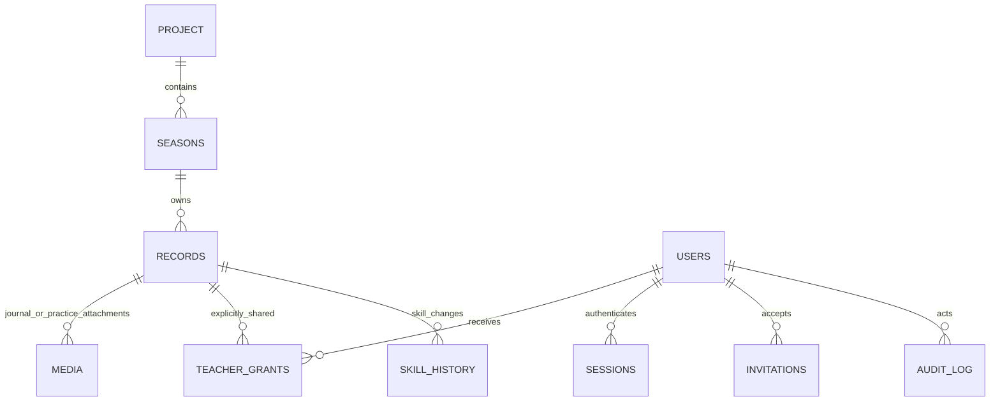

# Local pilot architecture and security decisions

Owner authorization: 2026-11-16. The local implementation supersedes the earlier B0-only limit. The follow-up requests continued implementation and **YouTube embeds only for video**. No deployment or production approval is implied.

## Short audit of the original main

Baseline: `36156a64c55effb67ee8cfd8c82cf0b1f3a426a5`. `index.html`, `styles.css`, `app.js`, `data.js` were a buildless vanilla-JS prototype with four views, responsive navigation, a draft curriculum, illustrative journal cards and a budget calculator. There was no server, dependency manifest, database, session boundary, media storage or payment system. The Node/MariaDB stack introduces no frontend framework requirement. The public HTML/CSS and reference data are preserved byte for byte; only the JS data/render adapter changes.

## Chosen structure

- Node 24 LTS, TypeScript, Fastify REST API, MariaDB (tested 11.4.13), vanilla JS admin and public clients.
- One process and same origin. All SQL uses parameters. Explicit asset routes replace an unsafe repository-wide static mount. The server never serves `.env`, source, SQL, backups or a media directory.
- `server/model.ts`: strict Zod input contracts. Money is integer VND, dates are ISO calendar dates, IDs are UUIDs. Counts, sizes, text and array lengths are bounded. Skill and lesson references stay in their season; prerequisite cycles are rejected.
- `server/auth.ts`: Argon2id (64 MiB, three passes), 256-bit random session tokens stored as SHA-256 hashes, absolute configurable expiry (8h default), opaque HttpOnly SameSite=Strict cookies. HTTPS uses Secure and the `__Host-` cookie prefix. Local HTTP must bind loopback. No localStorage credentials.
- Origin checks on API state changes, CSRF tokens on authenticated mutations, five login/invitation-accept attempts per IP/minute, bounded uploads, security headers. Local HTTP disables CSP's insecure-request upgrade so Safari does not upgrade localhost assets unexpectedly.
- Sessions persist in MariaDB and are checked against active users on each request. Logout removes a session; invited-user revocation removes all that user's sessions; teacher revocation also clears record grants. Regrant requires a new login. No automatic session renewal.
- The seed imports draft curriculum definitions only: 8 stages and 12 illustrative skill definitions, with no observed status or teacher approval. No fake journal, lesson, gift, expense or future season is seeded. The 104 lessons and 500–700k VND range are planning estimates, not completed lessons or an approved campaign target. Equipment and target remain null.

## Schema and transactions

`migrations/001_initial.sql` creates project, seasons, users, sessions, records, audit_log, skill_history, media and invitations; the runner adds migrations tracking. `002_teacher_and_practice_media.sql` adds the TEACHER role, invitation roles and per-record teacher_grants, then renames media ownership from journal_id to record_id, preserving existing attachments. Foreign keys bind records to seasons and media/grants to their owning records. Optional youtubeUrl values live in validated journal/practice JSON; older records normalize missing values to null without reseeding. Keep migrations immutable after release; add numbered migrations for future changes. Run one migrator at a time. MariaDB DDL implicitly commits: a partially failed migration requires inspection/recovery, not blindly marking it applied.

Seasons and typed records use validated JSON text payloads with indexed relational IDs/kinds/season references. This deliberate small-pilot choice avoids a table per form while retaining MariaDB persistence and strict server contracts. References inside JSON are checked in transactions, not native foreign keys. All mutation paths must retain those checks; a future larger deployment should normalize frequently queried fields and introduce version checks/pagination. The driver disables automatic JSON mapping so decoding is consistent.

Content writes serialize against the project row, and finance writes include before/after audit snapshots in the same transaction. Skill status/feedback changes also append skill_history. Audit details are parent-only; they contain private text and supporter fields but never passwords, invitation tokens or session tokens. The UI shows the latest 100 audit/history entries; the database retains earlier entries. Simultaneous edits use last-save-wins; multi-editor conflict resolution is not implemented.

Logical links for skill history, project current season, current stage and actor IDs are enforced by application workflows where applicable; the diagram is conceptual, not a claim that every line is a SQL foreign key.

## Access matrix

| Resource | Visitor | FAMILY_VIEWER | PARENT_ADMIN | TEACHER |
| --- | --- | --- | --- | --- |
| Approved project/catalogue/budget aggregate | Read | Read | Read | Read |
| Published PUBLIC posts/images/YouTube links | Read | Read | Manage | Read |
| Published FAMILY posts/images/YouTube links | Denied | Read | Manage | Denied |
| Draft/PARENT journal posts/images/YouTube links | Denied | Denied | Manage | Denied |
| Private practices/images/YouTube links | Denied | Denied | Manage | Read only explicitly assigned records |
| Personal skill status/feedback | Denied | Denied | Manage | Read/update feedback fields only on assigned skills |
| Lessons, supporter details, ledger, audit, invitations | Denied | Denied | Manage | Denied |
| Admin initialization | No HTTP endpoint | No HTTP endpoint | One-time CLI | Denied |

VISITOR is an unauthenticated request, not a stored account. Only a valid unexpired single-use invitation creates a FAMILY_VIEWER or TEACHER account; no registration endpoint accepts an arbitrary role. Invites expire after seven days, are manually shared outside the app and are stored hashed. All family viewers see all posts deliberately marked FAMILY; per-family-member sharing lists remain deferred.

A teacher starts with no assignments. The parent explicitly selects individual skills/practices, across seasons, in Admin. Granting a practice shares its notes, attached images and optional YouTube link. The teacher can save only status, teacherFeedback and teacherApproved for granted skills, with authenticated actor IDs in history/audit. Removing a record grant immediately blocks further protected reads/changes; revoking the account or its redeemed invite clears sessions and all grants. Regrant requires fresh login and fresh record assignments. Teachers do not inherit family access or see lesson costs, finances, supporters, other teachers' unassigned work or private journal records. Parent-entered feedback remains possible and its actor is distinguishable from an authenticated teacher's changes.

## API contract

All paths below are under `/api/v1`. JSON errors use `{ "error": "message" }`. Same-origin cookies are required for protected resources. Use `GET /me` to obtain the current CSRF token; mutations send it in `x-csrf-token`, plus an exact `Origin` matching APP_ORIGIN.

| Method | Path | Access / purpose |
| --- | --- | --- |
| GET | `/public/project`, `/public/catalogue`, `/public/budget`, `/public/journal` | Explicit public projections; no personal progress or supporter detail |
| POST | `/auth/login`, `/auth/logout` | Login is throttled; logout requires session and CSRF |
| GET | `/me` | Current user ID, role, CSRF; no-store |
| POST | `/auth/accept-invitation` | Throttled, one-use token, email, password ≥14 characters |
| GET | `/admin/state`, `/admin/audit/:id` | Parent-only state/financial summaries and audit snapshots |
| PUT | `/admin/project` | Project text and current public season |
| POST / PUT | `/admin/seasons` / `/admin/seasons/:id` | Explicit creation/edit; ordinal immutable; Season 1 always 24 months |
| POST / PUT | `/admin/records/:kind` / `/admin/records/:kind/:id` | Parent CRUD for stages, skills, lessons, practices, journal, contributions, expenses |
| DELETE | `/admin/journal/:id` | Parent deletes post and attachment references/files |
| GET | `/family/journal` | Authenticated published PUBLIC/FAMILY posts, parent sees all |
| POST / DELETE | `/admin/invitations` / `/admin/invitations/:id` | Issue/revoke; revoke also disables a redeemed account |
| DELETE / PUT | `/admin/users/:id` / `/admin/users/:id/access` | Revoke/regrant invited accounts; sessions invalidated, teacher scopes cleared on revocation |
| GET | `/journal/:id/media`, `/practices/:id/media`, `/media/:id` | Current record visibility or explicit teacher practice grant checked per request |
| POST / DELETE | `/admin/journal/:id/media`, `/admin/practices/:id/media` / `/admin/media/:id` | Parent-only image upload/deletion, throttled |
| DELETE | `/admin/practices/:id` | Parent deletes a practice and attached images/grants |
| PUT | `/admin/users/:id/grants` | Parent sets an active teacher's complete explicit skill/practice recordIds list |
| GET | `/teacher/state` | Teacher sees only assigned skills/practices |
| PATCH | `/teacher/skills/:id` | Assigned teacher writes only status, teacherFeedback, teacherApproved |

Record field definitions are in `server/model.ts`. The admin frontend uses the same field names. Contributions use `kind: gift|in_kind`; admin state distinguishes entity tables with `entity: contributions|expenses|...`.

## Finance semantics

- Received = **confirmed cash gifts**. Pending/void and in-kind support never increase cash receipts.
- Spent = recorded expenses. Voided expenses remain in history and are excluded from totals.
- Balance = received − spent. Negative balances are visible, not hidden.
- Unfunded = max(0, target − received), or null when no target is approved. Spending does not reopen a funded campaign.
- Target reached is computed separately from the parent-maintained lifecycle status. It does not auto-change a season's status.
- Lesson estimates = planned count × low/high unit estimate. Equipment and contingency are independent configuration; the parent approves the complete funding target explicitly.
- Recording a lesson cost never silently creates an expense. Record the payment once in Expenses and optionally link it to the lesson.
- Public finance starts disabled. `shareFinance` publishes aggregates only, never individual gifts, supporter identity or audit records. The acknowledgement flag records consent but does not expose identities in this pilot.
- Corrections save a new audit snapshot; void financial records instead of deleting them. Seasons archive without losing history. A newly created future season has no inherited records or target; unknown duration and numeric estimates can remain null in a draft.

## Private images and YouTube video links

Files live in MEDIA_DIR with generated keys, 0600 files and a 0700 directory where supported. The directory is outside the explicit public asset set and must stay outside any external web server's document root. Original names never become paths. Every media GET joins its live owner record and evaluates journal publication/visibility or the explicit teacher practice grant; no bearer permanent URL bypasses that decision. Responses are no-store. Public media requires an explicit PUBLIC, published post; uploaded media on a private/draft post stays private.

JPEG/PNG/WebP only: ≤5 MiB original file, ≤20 million decoded pixels, one image/request, ten/owning record, 200 images and 200 MiB sanitized data total. Sharp decodes and re-encodes WebP, auto-orients, bounds dimensions to 2400px and strips metadata (including location EXIF). Invalid/polyglot input that cannot decode is rejected; original bytes are not retained. Upload limit: ten/minute; deletion: twenty/minute per IP. Journal images inherit the post's visibility; practice images are parent-only except for an explicit teacher practice grant. Individual attachment ACLs remain deferred. Storage quota arithmetic converts MariaDB's DECIMAL SUM result to a number before adding bytes.

**Video file upload is excluded by owner choice (415); video uses YouTube links.** The journal/practice youtubeUrl field accepts only direct HTTPS video links from approved YouTube hosts, canonicalizes to a watch URL and rejects arbitrary iframe HTML, non-YouTube URLs, credential-bearing URLs and playlist/live-stream embed placeholders. The server does not fetch metadata, thumbnails or videos. Content APIs disclose the link only with the owning journal/practice record's permissions.

The shared `youtube.js` renders a button first: no YouTube frame or remote thumbnail is requested before a viewer clicks. Clicking creates a fixed `https://www.youtube-nocookie.com/embed/<validated-id>` iframe; CSP frame-src permits only that origin, with sandboxing and no autoplay. The iframe sends an origin-only Referer (`strict-origin-when-cross-origin`) so YouTube can identify the embedding site without receiving a private page path. Browser playback remains a real-device verification item.

**YouTube controls the video itself.** Website session revocation prevents further site disclosure, but cannot protect a copied unlisted YouTube URL. Private YouTube videos may require authorized YouTube/Google accounts, and embedding can be disabled by the video's owner. Confirm video consent, rights, public/unlisted/private settings and permitted viewers before using real material. No real videos were uploaded or fetched during this work; no automatic YouTube integration or account credentials are configured.

Deletion removes DB access first, then tries filesystem deletion. A crash or filesystem failure can leave inaccessible orphan files. `npm run media:cleanup` reports generated unreferenced files older than 24h; with the app stopped, `npm run media:cleanup -- --prune` removes them. Never prune during backup/restore. DB quota is not a replacement for an OS disk quota or a monitored storage limit.

## Threats and practical limits

Tests cover unauthenticated/admin and family boundaries, CSRF/origin, guessed media IDs, traversal attempts, malformed/oversized files, expiry/revocation, escaped content and login throttling. This is not a penetration test. A compromised parent account, untrusted device or copied/downloaded public image remains a risk. Revocation stops future server access, not copies already received. Do not log bodies/cookies/tokens at a reverse proxy. App request logging is disabled to avoid accidental sensitive logging; operational monitoring is still a production task.

Rate limits are process-local and IP-based, appropriate to this single-process local pilot. Multiple workers/proxies require a reviewed shared limiter and trusted-proxy configuration. Password reset/change, MFA, mail delivery, session-management UI, account recovery, concurrency conflict detection, pagination and teacher lesson-feedback scopes are not implemented. The preserved public Google Fonts requests contact a third party; decide on self-hosting/consent before production. Audit snapshots retain deleted post text; set retention/redaction and deletion-from-backups policy before recording real child data.

## Backup, retention and hosting gates

Back up MariaDB and MEDIA_DIR as a consistent pair while writes are stopped; encrypt the archive, keep it outside the repository and public roots, restrict access, and store encryption keys separately. Protect `.env` separately. After restore to an isolated instance, run migrations status checks, verify record/media counts and permissions, and delete restored sessions and invitation tokens before enabling access. Test that revoked users remain revoked and deleted/private media stays inaccessible. Choose a documented retention/deletion schedule and verify expiry of deleted data from backup rotations. A synthetic local drill has now passed: MariaDB dump plus a generated private WebP was encrypted with AES-256-GCM, restored to a separate local MariaDB 11.4 instance, and checked for matching table counts/image hash, private API denial, inactive-user preservation, purged sessions/invitations and deletion. The temporary test encryption key stayed in memory. This was not a target-host backup, rotation/retention test or real-data recovery exercise.

cPanel/CloudLinux is **unverified**, not a deployment target configured here. It must provide Node 24, long-running Node/Passenger support (possibly an ESM wrapper), MariaDB 10.11+ access, native Argon2/sharp support, writable private disk, HTTPS reverse proxy routing, environment secrets, private backups and enough memory (each Argon2 operation uses ~64 MiB). Shared hosting without these is a blocker. Do not commit secrets to bridge hosting limitations.

Portable alternative: run this same Node process under a supervised service on a small Linux VM/container host, with a separate MariaDB database and private persistent filesystem, behind reviewed HTTPS. Docker Compose in this repo is only a local database convenience. It does not deploy the application. Costs are OPEN: local software has no licence fee; hosting/database/backups/media storage/egress need current provider quotes and expected media volume. No imaginary production price or equipment budget is assigned.

Production remains NO-GO until the owner chooses hosting/origin, full Season 1 budget and schedule, shared-content/YouTube consent and settings, teacher participation, backups/retention and account recovery; private-media and permission review, target-host restore drill, load/resource tests and real-device checks must pass. No production readiness claim or payment integration is included.
